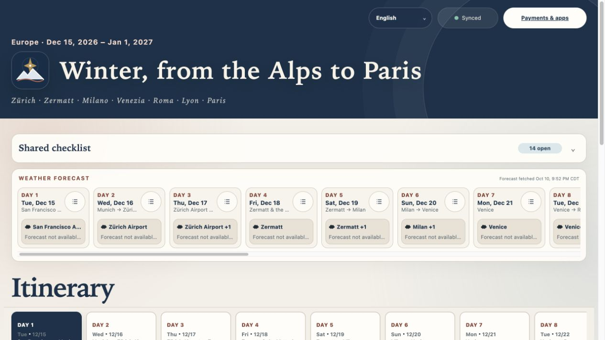
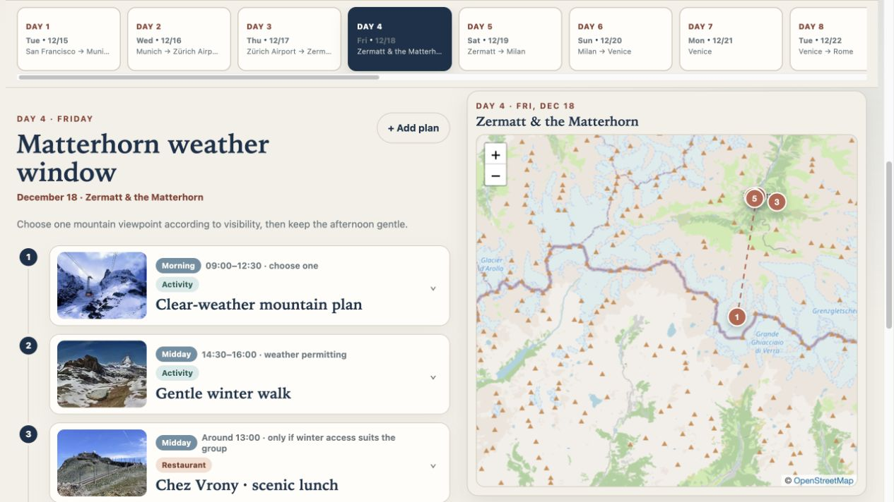
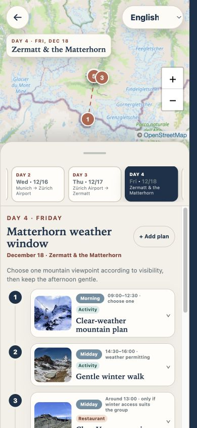
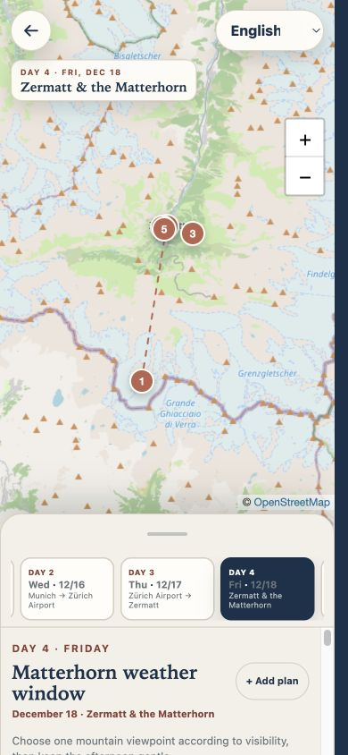
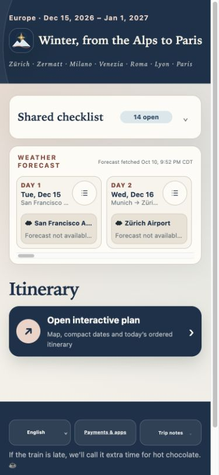

# One app, two interfaces

Captured from the existing winter-trip app on October 10, 2026. These are rendered application screenshots, not generated mockups. Only static previews are included here; the live shared-edit URL, private input documents, and Firebase configuration are intentionally not bundled.

## Website overview

A compact header leads into the full-width checklist and the horizontal forecast slider. The checklist does not stretch to match weather height, and its edges align with the weather panel. The plan-change timestamp is in the footer.

December dates are outside the forecast window at capture time, so the cards correctly show “Forecast not available yet.” These are not fabricated forecasts.

## Website itinerary

The selected day's timeline and a large sticky map share the workspace. Opening a plan or selecting a marker connects the two views. Desktop controls remain readable without taking space away from map exploration.

## iOS-oriented web app

The dedicated phone planner puts the map behind a rounded itinerary sheet, with date selection inside the sheet. Swipe its handle down for more map, or up for more itinerary. Tapping the handle alone does not resize it.

  
  

The homepage stays compact, with language, payments/apps, trip notes, and sync information in the footer:

## What these previews establish

- Desktop capture: default browser viewport, approximately 1280 × 720.
- Phone capture: 390 × 844 responsive browser viewport.
- The phone sheet was moved with a drag gesture for the map-focused capture.
- No screenshots claim a physical-device install test. Safari's Add to Home Screen flow, keyboard, date picker, safe-area behavior, and installed-PWA chrome must be checked on an actual iPhone.
- These implementation screenshots are illustrative. The reproducible repository demo in [`../docs/`](../docs/) contains a separate fictional trip and local-only edits, not this trip's data or live synchronization.

For a reproducible tour, run the fictional demo, explore the desktop map, narrow the browser to a phone width, choose **Open interactive plan**, and swipe the sheet handle. The [feature contract](../references/feature-contract.md) defines the behaviors future trips must preserve.

## Framework verification — October 10, 2026

- All nine regression groups and the repository privacy scan passed; a fresh generated app also passed static QA.
- The optional photo optimizer passed resizing, download-limit, local-asset, credit-preservation, and cached-preview tests using fixture images.
- Desktop and phone-width English, Simplified Chinese, Traditional Chinese, and Japanese views kept the same checklist height (62 px desktop, 78 px phone) without horizontal page overflow.
- The phone date input fit inside its dialog. A handle tap left the sheet at the same position; a drag lowered it while its bottom remained flush with the viewport.
- The rebuilt demo loaded under `/docs/`, including local preview images, date navigation, and weather dialogs. Narrow-phone navigation stayed inside that subpath, with no captured console warnings or errors.
- Service-worker tests verified root/subpath asset scope, retention of other applications' caches, and zero background fetches for warm versioned modules and local previews.

Not re-tested in this framework update: physical-iPhone installation, operating-system UI, two-device Firebase edits, or an actual offline browser session. The demo has no live Firebase backend, and its distant forecast dates have no forecast data yet.
